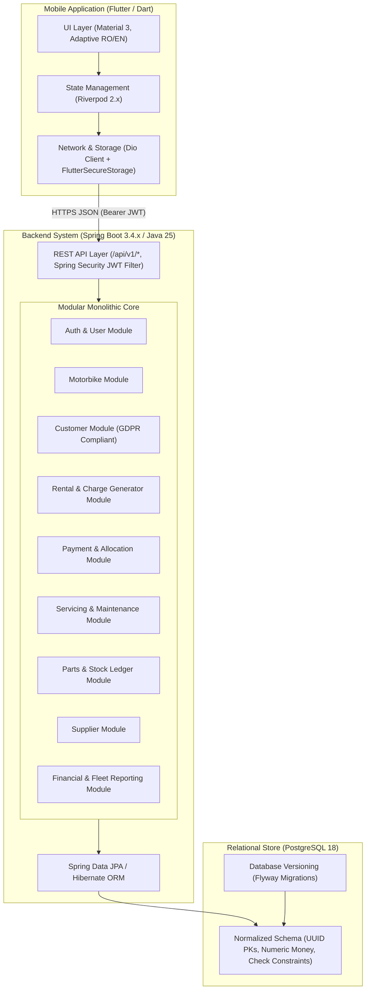

# Motorbike Rental Management System — System Architecture

**Target Domain:** Romanian Motorbike Fleet & Weekly Rental Operations  
**Architecture Pattern:** Modular Monolith (Backend) + Feature-Driven Reactive Mobile App (Flutter)  
**Primary Currencies:** RON, EUR, USD (Strict currency isolation, zero cross-currency aggregation)  
**Primary Locales:** Romanian (`ro_RO`) & English (`en_US` default)

---

## 1. High-Level System Architecture



---

## 2. Technology Stack & Key Rationale

| Layer | Technology | Version | Rationale & Responsibility |
| :--- | :--- | :--- | :--- |
| **Mobile App** | Flutter & Dart | Flutter 3.38+, Dart 3.10+ | Single high-performance codebase for Android & iOS with native Material 3 theming. |
| **State Mgmt** | Riverpod | 2.6+ | Compile-safe, testable state containers with seamless auto-dispose and family providers. |
| **HTTP Client** | Dio | 5.8+ | Interceptors for JWT auth token injection, automatic 401 refresh/logout, and structured error handling. |
| **Secure Store** | flutter_secure_storage | 9.2+ | Encrypted Keystore (Android) and Keychain (iOS) for JWT auth tokens. |
| **Localization** | Flutter Intl / ARB | gen-l10n | Native type-safe localization supporting Romanian (`ro`) as primary and English (`en`). |
| **Backend** | Spring Boot | 3.4.x | Robust enterprise framework with production-grade transaction management and validation. |
| **Language** | Java | 25 (LTS) | Modern Java records, pattern matching, virtual threads, and strong type safety. |
| **Security** | Spring Security 6.x | Latest | Stateless JWT bearer authentication, Argon2/BCrypt password hashing, method-level security. |
| **Persistence** | Spring Data JPA / Hibernate | 6.x | Typed repositories, optimistic concurrency control (`@Version`), and native query optimization. |
| **Migrations** | Flyway | 10.x | Reproducible, versioned SQL schema migrations. |
| **Database** | PostgreSQL | 18 | Strong ACID guarantees, `NUMERIC` precision for multi-currency calculations, `TIMESTAMPTZ` handling. |
| **API Docs** | Springdoc OpenAPI | 2.8+ | Auto-generated Swagger UI and OpenAPI v3 spec for Postman and mobile team integration. |

---

## 3. Modular Monolithic Structure (Backend)

The backend avoids distributed microservice complexity while enforcing strict boundaries between business modules:

```
backend/
├── src/main/java/ro/bikerental/
│   ├── BikeRentalApplication.java
│   │
│   ├── common/                       # Shared cross-cutting concerns
│   │   ├── config/                   # WebMvc, Jackson, OpenAPI, Auditing configs
│   │   ├── currency/                 # SupportedCurrency enum (RON, EUR, USD), MoneyValue VO
│   │   ├── exception/                # GlobalExceptionHandler, BusinessException, ErrorResponse
│   │   ├── pagination/               # PageRequestDto, PagedResponseDto
│   │   └── security/                 # JwtTokenProvider, SecurityConfig, UserPrincipal
│   │
│   ├── modules/
│   │   ├── auth/                     # Owner authentication, token refresh, password change
│   │   ├── bike/                     # Motorbike fleet, status lifecycle, document expirations
│   │   ├── customer/                 # Customer profiles, driving licenses, GDPR consent
│   │   ├── rental/                   # Rental agreements, recurring weekly charge generation engine
│   │   ├── payment/                  # Manual cash/bank transfer recording, FIFO allocation, reversals
│   │   ├── service/                  # Maintenance logs, mechanics, transactional part usage
│   │   ├── inventory/                # Parts catalogue, stock-in/out, immutable stock movement ledger
│   │   ├── supplier/                 # Supplier contacts, purchase references
│   │   └── report/                   # Multi-currency dashboard KPIs, debt agings, financial reports
│   │
│   └── resources/
│       ├── application.yml           # Base configuration
│       ├── application-dev.yml       # Dev profile with local PostgreSQL connection
│       ├── application-prod.yml      # Production profile
│       └── db/migration/             # Flyway SQL migrations (V1__init_schema.sql, etc.)
```

---

## 4. Flutter Project Modular Structure

```
mobile/
├── android/
├── ios/
├── assets/
│   ├── icons/
│   └── images/
├── l10n/
│   ├── app_ro.arb                    # Romanian translation bundle (Default)
│   └── app_en.arb                    # English translation bundle
├── lib/
│   ├── app/
│   │   ├── app.dart                  # MaterialApp.router configuration
│   │   └── routes.dart               # GoRouter declarative routing with auth guards
│   ├── core/
│   │   ├── config/                   # Environment variables, API base URLs
│   │   ├── constants/                # AppConstants, CurrencyConstants (RON, EUR, USD)
│   │   ├── localization/             # Generated L10n helpers, locale providers
│   │   ├── network/                  # Dio client, AuthInterceptor, ErrorInterceptor
│   │   ├── storage/                  # SecureStorageService (JWT token management)
│   │   ├── theme/                    # AppTheme (Vibrant dark/light mode, custom typography)
│   │   ├── utils/                    # CurrencyFormatter, DateFormatter (Europe/Bucharest)
│   │   └── widgets/                  # Reusable form fields, buttons, status badges, dialogs
│   ├── features/
│   │   ├── auth/                     # LoginScreen, AuthStateNotifier, AuthRepository
│   │   ├── dashboard/                # DashboardScreen, KPI metric cards, currency selector
│   │   ├── bikes/                    # BikeListScreen, BikeDetailScreen, BikeFormScreen
│   │   ├── customers/                # CustomerListScreen, CustomerDetailScreen, CustomerFormScreen
│   │   ├── rentals/                  # RentalListScreen, CreateRentalScreen, RentalDetailScreen
│   │   ├── payments/                 # CollectPaymentScreen, PaymentHistoryScreen, ReceiptScreen
│   │   ├── services/                 # ServiceListScreen, LogServiceScreen, ServiceDetailScreen
│   │   ├── inventory/                # PartListScreen, StockMovementScreen, StockAdjustDialog
│   │   ├── suppliers/                # SupplierListScreen, SupplierFormScreen
│   │   ├── reports/                  # FinancialReportsScreen, FleetReportScreen, ExportCsv
│   │   └── settings/                 # SettingsScreen, LanguageSelector, BusinessProfileScreen
│   └── main.dart                     # App entry point, ProviderScope initialization
└── test/                             # Unit, widget, and mock API tests
```

---

## 5. Security Architecture

1. **Authentication:** 
   - Stateless JWT tokens (HMAC-SHA256 / RSA).
   - Passwords hashed using standard BCrypt (strength 12) or Argon2.
   - Initial owner setup script provided; no hardcoded credentials in source code.
2. **Authorization:**
   - Role-based authorization (`ROLE_OWNER`, `ROLE_ADMIN`).
   - Every API endpoint requires authentication except `/api/v1/auth/login`.
3. **Data Protection (GDPR Compliance):**
   - Customer personal data (CNP, phone, address, passport) collected strictly for legal rental contracts.
   - Soft-archiving implemented: Customers and motorbikes are archived (`archived = true`) rather than hard-deleted to preserve financial and accounting audit trails.
   - PII fields masked in application logs.
4. **Transport Security:**
   - HTTPS mandatory in production.
   - HSTS and secure HTTP security headers configured in Spring Security.
