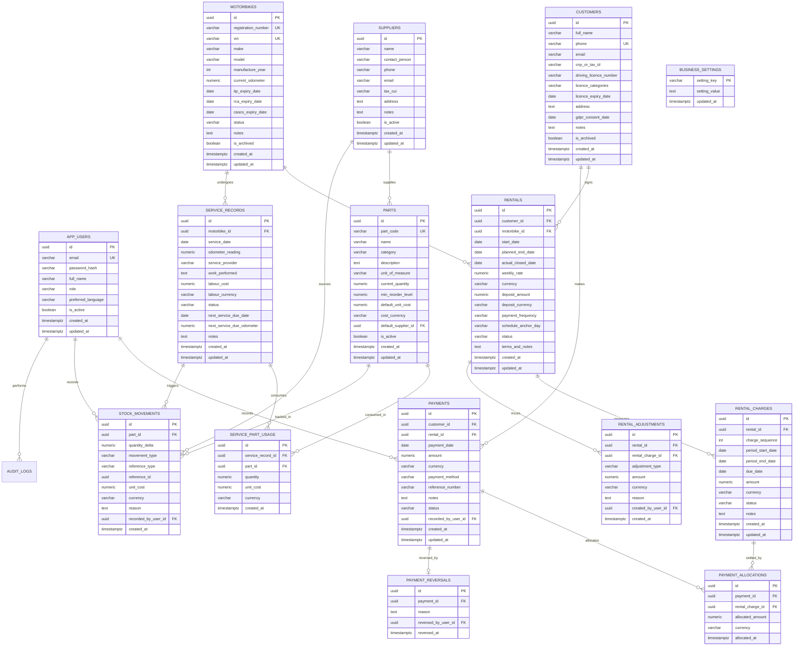

# Motorbike Rental Management System — Database Architecture & ER Diagram

## 1. Entity-Relationship (ER) Diagram



---

## 2. Table Specifications & Integrity Rules

### 2.1 Referential Integrity & Safe Deletion
- **No Cascade Deletion on Financial or Audit Trails:**
  - `RENTALS` → `CUSTOMERS` and `MOTORBIKES` uses `ON DELETE RESTRICT`. Customers or motorbikes with rental records cannot be hard deleted.
  - `RENTAL_CHARGES` → `RENTALS` uses `ON DELETE RESTRICT`.
  - `PAYMENTS` → `CUSTOMERS` uses `ON DELETE RESTRICT`.
  - `PAYMENT_ALLOCATIONS` → `PAYMENTS` and `RENTAL_CHARGES` uses `ON DELETE RESTRICT`.
  - `STOCK_MOVEMENTS` → `PARTS` uses `ON DELETE RESTRICT`.

### 2.2 Currency Integrity Constraints
Every monetary column pairs with a currency check constraint:
```sql
CHECK (currency IN ('RON', 'EUR', 'USD'))
```
When allocating a payment:
```sql
-- Validated in service layer and trigger:
-- payment.currency == rental_charge.currency == payment_allocation.currency
```

### 2.3 Concurrency & Stock Invariant
The inventory balance invariant is enforced via atomic update:
```sql
UPDATE parts 
SET current_quantity = current_quantity + :delta,
    updated_at = CURRENT_TIMESTAMP
WHERE id = :partId AND (current_quantity + :delta >= 0);
```
If the rows affected is 0, it signals insufficient inventory, raising a business exception and rolling back the transaction.

---

## 3. Initial PostgreSQL Schema DDL (Flyway V1 Script Preview)

```sql
-- Flyway Migration V1: Initial Motorbike Rental System Schema
CREATE EXTENSION IF NOT EXISTS "pgcrypto";

-- 1. App Users (Owner / Admin)
CREATE TABLE app_users (
    id UUID PRIMARY KEY DEFAULT gen_random_uuid(),
    email VARCHAR(255) NOT NULL UNIQUE,
    password_hash VARCHAR(255) NOT NULL,
    full_name VARCHAR(150) NOT NULL,
    role VARCHAR(50) NOT NULL DEFAULT 'ROLE_OWNER',
    preferred_language VARCHAR(10) NOT NULL DEFAULT 'en',
    is_active BOOLEAN NOT NULL DEFAULT TRUE,
    created_at TIMESTAMPTZ NOT NULL DEFAULT CURRENT_TIMESTAMP,
    updated_at TIMESTAMPTZ NOT NULL DEFAULT CURRENT_TIMESTAMP
);

-- 2. Customers
CREATE TABLE customers (
    id UUID PRIMARY KEY DEFAULT gen_random_uuid(),
    full_name VARCHAR(150) NOT NULL,
    phone VARCHAR(30) NOT NULL UNIQUE,
    email VARCHAR(150),
    cnp_or_tax_id VARCHAR(50),
    driving_licence_number VARCHAR(50),
    licence_categories VARCHAR(50) DEFAULT 'A,A2',
    licence_expiry_date DATE,
    address TEXT,
    gdpr_consent_date DATE,
    notes TEXT,
    is_archived BOOLEAN NOT NULL DEFAULT FALSE,
    created_at TIMESTAMPTZ NOT NULL DEFAULT CURRENT_TIMESTAMP,
    updated_at TIMESTAMPTZ NOT NULL DEFAULT CURRENT_TIMESTAMP
);
CREATE INDEX idx_customers_phone ON customers(phone);
CREATE INDEX idx_customers_full_name ON customers(full_name);
CREATE INDEX idx_customers_cnp ON customers(cnp_or_tax_id);

-- 3. Motorbikes
CREATE TABLE motorbikes (
    id UUID PRIMARY KEY DEFAULT gen_random_uuid(),
    registration_number VARCHAR(20) NOT NULL UNIQUE,
    vin VARCHAR(30) NOT NULL UNIQUE,
    make VARCHAR(50) NOT NULL,
    model VARCHAR(50) NOT NULL,
    manufacture_year INT NOT NULL CHECK (manufacture_year >= 1990 AND manufacture_year <= 2050),
    current_odometer NUMERIC(10, 1) NOT NULL DEFAULT 0.0 CHECK (current_odometer >= 0),
    itp_expiry_date DATE,
    rca_expiry_date DATE,
    casco_expiry_date DATE,
    status VARCHAR(20) NOT NULL DEFAULT 'AVAILABLE' CHECK (status IN ('AVAILABLE', 'RENTED', 'IN_SERVICE', 'INACTIVE')),
    notes TEXT,
    is_archived BOOLEAN NOT NULL DEFAULT FALSE,
    created_at TIMESTAMPTZ NOT NULL DEFAULT CURRENT_TIMESTAMP,
    updated_at TIMESTAMPTZ NOT NULL DEFAULT CURRENT_TIMESTAMP
);
CREATE INDEX idx_motorbikes_reg ON motorbikes(registration_number);
CREATE INDEX idx_motorbikes_status ON motorbikes(status);

-- 4. Suppliers
CREATE TABLE suppliers (
    id UUID PRIMARY KEY DEFAULT gen_random_uuid(),
    name VARCHAR(150) NOT NULL,
    contact_person VARCHAR(100),
    phone VARCHAR(30),
    email VARCHAR(150),
    tax_cui VARCHAR(50),
    address TEXT,
    notes TEXT,
    is_active BOOLEAN NOT NULL DEFAULT TRUE,
    created_at TIMESTAMPTZ NOT NULL DEFAULT CURRENT_TIMESTAMP,
    updated_at TIMESTAMPTZ NOT NULL DEFAULT CURRENT_TIMESTAMP
);

-- 5. Parts Catalog
CREATE TABLE parts (
    id UUID PRIMARY KEY DEFAULT gen_random_uuid(),
    part_code VARCHAR(50) NOT NULL UNIQUE,
    name VARCHAR(150) NOT NULL,
    category VARCHAR(50) NOT NULL,
    description TEXT,
    unit_of_measure VARCHAR(20) NOT NULL DEFAULT 'PCS',
    current_quantity NUMERIC(10, 2) NOT NULL DEFAULT 0.00 CHECK (current_quantity >= 0),
    min_reorder_level NUMERIC(10, 2) NOT NULL DEFAULT 2.00,
    default_unit_cost NUMERIC(14, 2) NOT NULL DEFAULT 0.00 CHECK (default_unit_cost >= 0),
    cost_currency VARCHAR(3) NOT NULL DEFAULT 'RON' CHECK (cost_currency IN ('RON', 'EUR', 'USD')),
    default_supplier_id UUID REFERENCES suppliers(id) ON DELETE SET NULL,
    is_active BOOLEAN NOT NULL DEFAULT TRUE,
    created_at TIMESTAMPTZ NOT NULL DEFAULT CURRENT_TIMESTAMP,
    updated_at TIMESTAMPTZ NOT NULL DEFAULT CURRENT_TIMESTAMP
);
CREATE INDEX idx_parts_code ON parts(part_code);
CREATE INDEX idx_parts_category ON parts(category);

-- 6. Rentals
CREATE TABLE rentals (
    id UUID PRIMARY KEY DEFAULT gen_random_uuid(),
    customer_id UUID NOT NULL REFERENCES customers(id) ON DELETE RESTRICT,
    motorbike_id UUID NOT NULL REFERENCES motorbikes(id) ON DELETE RESTRICT,
    start_date DATE NOT NULL,
    planned_end_date DATE,
    actual_closed_date DATE,
    weekly_rate NUMERIC(14, 2) NOT NULL CHECK (weekly_rate > 0),
    currency VARCHAR(3) NOT NULL CHECK (currency IN ('RON', 'EUR', 'USD')),
    deposit_amount NUMERIC(14, 2) NOT NULL DEFAULT 0.00 CHECK (deposit_amount >= 0),
    deposit_currency VARCHAR(3) NOT NULL DEFAULT 'RON' CHECK (deposit_currency IN ('RON', 'EUR', 'USD')),
    payment_frequency VARCHAR(20) NOT NULL DEFAULT 'WEEKLY',
    schedule_anchor_day VARCHAR(15) NOT NULL DEFAULT 'START_DAY',
    status VARCHAR(20) NOT NULL DEFAULT 'ACTIVE' CHECK (status IN ('ACTIVE', 'CLOSED', 'CANCELLED')),
    terms_and_notes TEXT,
    created_at TIMESTAMPTZ NOT NULL DEFAULT CURRENT_TIMESTAMP,
    updated_at TIMESTAMPTZ NOT NULL DEFAULT CURRENT_TIMESTAMP
);
-- Partial index enforcing only one ACTIVE rental per motorbike
CREATE UNIQUE INDEX uq_active_rental_per_bike ON rentals(motorbike_id) WHERE (status = 'ACTIVE');
CREATE INDEX idx_rentals_customer ON rentals(customer_id);
CREATE INDEX idx_rentals_status ON rentals(status);

-- 7. Rental Charges
CREATE TABLE rental_charges (
    id UUID PRIMARY KEY DEFAULT gen_random_uuid(),
    rental_id UUID NOT NULL REFERENCES rentals(id) ON DELETE RESTRICT,
    charge_sequence INT NOT NULL CHECK (charge_sequence > 0),
    period_start_date DATE NOT NULL,
    period_end_date DATE NOT NULL,
    due_date DATE NOT NULL,
    amount NUMERIC(14, 2) NOT NULL CHECK (amount > 0),
    currency VARCHAR(3) NOT NULL CHECK (currency IN ('RON', 'EUR', 'USD')),
    status VARCHAR(20) NOT NULL DEFAULT 'UNPAID' CHECK (status IN ('UNPAID', 'PARTIALLY_PAID', 'PAID', 'CANCELLED')),
    notes TEXT,
    created_at TIMESTAMPTZ NOT NULL DEFAULT CURRENT_TIMESTAMP,
    updated_at TIMESTAMPTZ NOT NULL DEFAULT CURRENT_TIMESTAMP,
    CONSTRAINT uq_rental_charge_seq UNIQUE (rental_id, charge_sequence)
);
CREATE INDEX idx_charges_due_date ON rental_charges(due_date);
CREATE INDEX idx_charges_status ON rental_charges(status);

-- 8. Payments
CREATE TABLE payments (
    id UUID PRIMARY KEY DEFAULT gen_random_uuid(),
    customer_id UUID NOT NULL REFERENCES customers(id) ON DELETE RESTRICT,
    rental_id UUID REFERENCES rentals(id) ON DELETE SET NULL,
    payment_date DATE NOT NULL,
    amount NUMERIC(14, 2) NOT NULL CHECK (amount > 0),
    currency VARCHAR(3) NOT NULL CHECK (currency IN ('RON', 'EUR', 'USD')),
    payment_method VARCHAR(30) NOT NULL CHECK (payment_method IN ('CASH', 'BANK_TRANSFER')),
    reference_number VARCHAR(100),
    notes TEXT,
    status VARCHAR(20) NOT NULL DEFAULT 'CONFIRMED' CHECK (status IN ('CONFIRMED', 'REVERSED')),
    recorded_by_user_id UUID NOT NULL REFERENCES app_users(id) ON DELETE RESTRICT,
    created_at TIMESTAMPTZ NOT NULL DEFAULT CURRENT_TIMESTAMP,
    updated_at TIMESTAMPTZ NOT NULL DEFAULT CURRENT_TIMESTAMP
);
CREATE INDEX idx_payments_customer ON payments(customer_id);
CREATE INDEX idx_payments_date ON payments(payment_date);

-- 9. Payment Allocations
CREATE TABLE payment_allocations (
    id UUID PRIMARY KEY DEFAULT gen_random_uuid(),
    payment_id UUID NOT NULL REFERENCES payments(id) ON DELETE RESTRICT,
    rental_charge_id UUID NOT NULL REFERENCES rental_charges(id) ON DELETE RESTRICT,
    allocated_amount NUMERIC(14, 2) NOT NULL CHECK (allocated_amount > 0),
    currency VARCHAR(3) NOT NULL CHECK (currency IN ('RON', 'EUR', 'USD')),
    allocated_at TIMESTAMPTZ NOT NULL DEFAULT CURRENT_TIMESTAMP
);
CREATE INDEX idx_alloc_payment ON payment_allocations(payment_id);
CREATE INDEX idx_alloc_charge ON payment_allocations(rental_charge_id);

-- 10. Payment Reversals
CREATE TABLE payment_reversals (
    id UUID PRIMARY KEY DEFAULT gen_random_uuid(),
    payment_id UUID NOT NULL UNIQUE REFERENCES payments(id) ON DELETE RESTRICT,
    reason TEXT NOT NULL,
    reversed_by_user_id UUID NOT NULL REFERENCES app_users(id) ON DELETE RESTRICT,
    reversed_at TIMESTAMPTZ NOT NULL DEFAULT CURRENT_TIMESTAMP
);

-- 11. Rental Adjustments
CREATE TABLE rental_adjustments (
    id UUID PRIMARY KEY DEFAULT gen_random_uuid(),
    rental_id UUID NOT NULL REFERENCES rentals(id) ON DELETE RESTRICT,
    rental_charge_id UUID REFERENCES rental_charges(id) ON DELETE SET NULL,
    adjustment_type VARCHAR(30) NOT NULL CHECK (adjustment_type IN ('DISCOUNT', 'LATE_FEE', 'DAMAGE_CHARGE', 'WAIVER')),
    amount NUMERIC(14, 2) NOT NULL,
    currency VARCHAR(3) NOT NULL CHECK (currency IN ('RON', 'EUR', 'USD')),
    reason TEXT NOT NULL,
    created_by_user_id UUID NOT NULL REFERENCES app_users(id) ON DELETE RESTRICT,
    created_at TIMESTAMPTZ NOT NULL DEFAULT CURRENT_TIMESTAMP
);

-- 12. Service Records
CREATE TABLE service_records (
    id UUID PRIMARY KEY DEFAULT gen_random_uuid(),
    motorbike_id UUID NOT NULL REFERENCES motorbikes(id) ON DELETE RESTRICT,
    service_date DATE NOT NULL,
    odometer_reading NUMERIC(10, 1) NOT NULL CHECK (odometer_reading >= 0),
    service_provider VARCHAR(150) NOT NULL,
    work_performed TEXT NOT NULL,
    labour_cost NUMERIC(14, 2) NOT NULL DEFAULT 0.00 CHECK (labour_cost >= 0),
    labour_currency VARCHAR(3) NOT NULL DEFAULT 'RON' CHECK (labour_currency IN ('RON', 'EUR', 'USD')),
    status VARCHAR(20) NOT NULL DEFAULT 'PLANNED' CHECK (status IN ('PLANNED', 'IN_PROGRESS', 'COMPLETED', 'CANCELLED')),
    next_service_due_date DATE,
    next_service_due_odometer NUMERIC(10, 1),
    notes TEXT,
    created_at TIMESTAMPTZ NOT NULL DEFAULT CURRENT_TIMESTAMP,
    updated_at TIMESTAMPTZ NOT NULL DEFAULT CURRENT_TIMESTAMP
);
CREATE INDEX idx_services_bike ON service_records(motorbike_id);
CREATE INDEX idx_services_date ON service_records(service_date);

-- 13. Service Part Usage
CREATE TABLE service_part_usage (
    id UUID PRIMARY KEY DEFAULT gen_random_uuid(),
    service_record_id UUID NOT NULL REFERENCES service_records(id) ON DELETE RESTRICT,
    part_id UUID NOT NULL REFERENCES parts(id) ON DELETE RESTRICT,
    quantity NUMERIC(10, 2) NOT NULL CHECK (quantity > 0),
    unit_cost NUMERIC(14, 2) NOT NULL DEFAULT 0.00 CHECK (unit_cost >= 0),
    currency VARCHAR(3) NOT NULL DEFAULT 'RON' CHECK (currency IN ('RON', 'EUR', 'USD')),
    created_at TIMESTAMPTZ NOT NULL DEFAULT CURRENT_TIMESTAMP
);

-- 14. Stock Movements (Immutable Ledger)
CREATE TABLE stock_movements (
    id UUID PRIMARY KEY DEFAULT gen_random_uuid(),
    part_id UUID NOT NULL REFERENCES parts(id) ON DELETE RESTRICT,
    quantity_delta NUMERIC(10, 2) NOT NULL,
    movement_type VARCHAR(30) NOT NULL CHECK (movement_type IN ('STOCK_IN', 'STOCK_OUT', 'SERVICE_USAGE', 'RETURN', 'ADJUSTMENT', 'REVERSAL')),
    reference_type VARCHAR(50),
    reference_id UUID,
    unit_cost NUMERIC(14, 2) DEFAULT 0.00,
    currency VARCHAR(3) DEFAULT 'RON' CHECK (currency IN ('RON', 'EUR', 'USD')),
    reason TEXT,
    recorded_by_user_id UUID NOT NULL REFERENCES app_users(id) ON DELETE RESTRICT,
    created_at TIMESTAMPTZ NOT NULL DEFAULT CURRENT_TIMESTAMP
);
CREATE INDEX idx_stock_movements_part ON stock_movements(part_id);
CREATE INDEX idx_stock_movements_type ON stock_movements(movement_type);

-- 15. Business Settings
CREATE TABLE business_settings (
    setting_key VARCHAR(100) PRIMARY KEY,
    setting_value TEXT NOT NULL,
    updated_at TIMESTAMPTZ NOT NULL DEFAULT CURRENT_TIMESTAMP
);
