# Motorbike Rental Management System — Flutter Screen & Navigation Plan

## 1. Information Architecture & Navigation Hierarchy

The application employs an adaptive Material 3 Navigation Shell with a bottom navigation bar for primary daily flows, plus dedicated detail/form routes managed via `GoRouter`.

```mermaid
graph TD
    Splash["/ (Splash / Auth Check)"] -->|Unauthenticated| Login["/login (Autentificare)"]
    Splash -->|Authenticated| Shell["/app (ScaffoldWithNavBar)"]

    Shell --> Tab1["/app/dashboard (Panou de control)"]
    Shell --> Tab2["/app/bikes (Motociclete)"]
    Shell --> Tab3["/app/rentals (Închirieri)"]
    Shell --> Tab4["/app/payments (Plăți)"]
    Shell --> Tab5["/app/more (Mai multe / Meniu)"]

    Tab2 --> BikeDetails["/app/bikes/:id (Detalii motocicletă)"]
    Tab2 --> BikeForm["/app/bikes/new & /app/bikes/:id/edit"]

    Tab3 --> RentalDetails["/app/rentals/:id (Detalii contract)"]
    Tab3 --> RentalForm["/app/rentals/new (Contract nou)"]
    RentalDetails --> CloseRental["/app/rentals/:id/close (Închidere contract)"]

    Tab4 --> CollectPayment["/app/payments/collect (Încasare chirie)"]
    Tab4 --> PaymentDetails["/app/payments/:id (Chitanță / Detalii plată)"]

    Tab5 --> Customers["/app/customers (Clienți)"]
    Customers --> CustomerDetails["/app/customers/:id"]
    Customers --> CustomerForm["/app/customers/new"]

    Tab5 --> Services["/app/services (Service & Întreținere)"]
    Services --> ServiceDetails["/app/services/:id"]
    Services --> ServiceForm["/app/services/new (Înregistrare service)"]

    Tab5 --> Inventory["/app/inventory (Piese de schimb)"]
    Inventory --> PartDetails["/app/inventory/:id"]
    Inventory --> StockInOut["/app/inventory/movement (Intrare / Ieșire stoc)"]

    Tab5 --> Reports["/app/reports (Rapoarte financiare & flotă)"]
    Tab5 --> Settings["/app/settings (Setări & Limbă)"]
```

---

## 2. Screen Specifications & Features

### 2.1 Login Screen (`/login`)
- Clean, focused mobile login card with business branding.
- Email, Password, Remember Me toggle.
- Full validation with instant visual feedback.
- Network error handling with localized error snackbars.

### 2.2 Dashboard Screen (`/app/dashboard`)
- **Header:** Business greeting, current date in English/Romanian, quick language switch chip (`EN` / `RO`).
- **Fleet Status Row:** Clickable KPI cards (Total: 24, Available: 8, Rented: 14, In Service: 2). Tapping filters the Bikes screen directly.
- **Financial Balances by Currency:**
  - Distinct cards for `RON`, `EUR`, and `USD`.
  - Shows: Weekly Rent Collected (Luna curentă) & Outstanding Balances (Sold restant).
- **Urgent Action Alerts:**
  - "2 plăți scadente astăzi" (Click to collect).
  - "3 motociclete necesită ITP / Service curând".
  - "4 piese sub stocul minim".
- **Recent Activity Feed:** Last 5 payments and rental events.

### 2.3 Motorbike Fleet (`/app/bikes`)
- Search bar (Filter by plate `B 123 BIK`, VIN, or model).
- Status segmented control (`Toate`, `Disponibile`, `Închiriate`, `În Service`, `Inactive`).
- Card layout displaying: Plate number, Make & Model, Current km, RCA & ITP status badge (Green = Valid, Amber = Expiring < 30 days, Red = Expired).
- Detail View: Full vehicle sheet, active tenant name with phone call shortcut, complete rental history timeline, and full service logs.

### 2.4 Rental Contracts (`/app/rentals`)
- Active, Closed, and Upcoming tabs.
- Contract Creation Wizard:
  1. Select Customer (or create new inline).
  2. Select Available Motorbike (only status `AVAILABLE` displayed).
  3. Set Weekly Price & Currency (`RON`, `EUR`, `USD`).
  4. Set Deposit & Payment Schedule anchor (Start Day or Fixed Day).
  5. Sign terms & confirm.
- Agreement Detail View:
  - Contract summary card.
  - Interactive Weekly Charges Ledger: Shows all generated charges, period dates, amounts, status badges (`Plătit`, `Parțial`, `Neplătit`), and remaining balance.
  - Direct "Încasează Plată" action button pre-filling the customer and rental.
  - "Închide Contract" button launching the deposit settlement modal.

### 2.5 Payments & Collections (`/app/payments`)
- **Primary Action FAB:** "Încasare Nouă" (Collect Payment).
- Tabs: `Restanțe & Scadențe` (Overdue & Due Charges) and `Istoric Plăți` (Payment History).
- Payment Collection Flow:
  1. Select Customer.
  2. System shows all unpaid charges in the customer's currency.
  3. Enter Payment Amount, Currency, and Method (`Cash`, `Transfer bancar`).
  4. Allocation Mode: Toggle between Auto FIFO or Manual Selection (checkboxes per weekly charge).
  5. Add optional reference/receipt number.
  6. Confirm and view/share generated digital receipt (*Confirmare de plată*).
- Payment Detail & Reversal:
  - View exact breakdown of which weekly charges were covered by this payment.
  - "Revocare Plată" (Payment Reversal) with mandatory confirmation and reason entry.

### 2.6 Servicing & Maintenance (`/app/services`)
- Service logs filtered by bike.
- New Service Sheet:
  - Select Bike (shows current odometer).
  - Enter new odometer reading (validated $\ge$ current odometer).
  - Labour cost & currency.
  - Mechanic / service shop name.
  - Add Parts Used: Autocomplete part from inventory, specify quantity; displays real-time stock availability and warns if stock is low.
  - Save: Updates bike odometer, bike status, and inventory ledger in one step.

### 2.7 Spare Parts Inventory (`/app/inventory`)
- Category tabs: `Toate`, `Filtre`, `Plăcuțe frână`, `Ulei & Lichide`, `Anvelope`, `Electrice`.
- Low-Stock Highlight: Badges parts where `quantity <= min_reorder_level`.
- Quick Actions: `Intrare Stoc` (Stock In) & `Ieșire Stoc` (Stock Out / Adjustment).
- Stock Movement Audit Tab: Every single quantity change with user, date, reason, and reference.

### 2.8 Reports & Analytics (`/app/reports`)
- Date range picker (Today, This Week, This Month, Custom).
- Multi-currency income summary (RON, EUR, USD separately).
- Expense summary (Parts purchase + Service labour).
- Fleet utilization rate (%).
- CSV Export button for accounting data.

---

## 3. English & Romanian Localization Resource Mapping

| Key | English (Default) | Romanian |
| :--- | :--- | :--- |
| `appTitle` | Moto Rental Management | Închirieri Moto România |
| `navDashboard` | Dashboard | Panou de control |
| `navBikes` | Motorbikes | Motociclete |
| `navRentals` | Rentals | Închirieri |
| `navPayments` | Payments | Plăți |
| `navMore` | More | Meniu |
| `statusAvailable` | Available | Disponibilă |
| `statusRented` | Rented | Închiriată |
| `statusInService` | In Service | În service |
| `statusInactive` | Inactive | Inactivă |
| `statusUnpaid` | Unpaid | Neachitat |
| `statusPartiallyPaid` | Partially Paid | Achitat parțial |
| `statusPaid` | Paid | Achitat integral |
| `weeklyRate` | Weekly Rate | Chirie săptămânală |
| `deposit` | Deposit | Garanție |
| `collectPayment` | Collect Payment | Încasare plată |
| `reversePayment` | Reverse Payment | Revocare plată |
| `paymentCash` | Cash | Numerar (Cash) |
| `paymentTransfer` | Bank Transfer | Transfer bancar |
| `stockIn` | Stock In | Intrare stoc |
| `stockOut` | Stock Out | Ieșire stoc |
| `lowStock` | Low Stock | Stoc scăzut |
| `currencyRon` | Romanian Leu (RON) | Lei (RON) |
| `currencyEur` | Euro (EUR) | Euro (EUR) |
| `currencyUsd` | US Dollar (USD) | Dolari (USD) |
| `confirmAction` | Confirm Action | Confirmați acțiunea |
| `cancel` | Cancel | Anulare |
| `save` | Save | Salvează |
